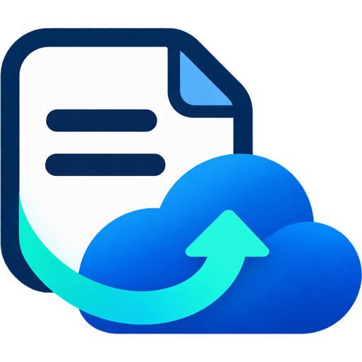

# Notion Backup → OneDrive



Home-Assistant-Custom-Integration für tägliche **ZIP-Sicherungen von Notion-Inhalten und Anhängen** nach OneDrive. Mehrere Notion-Verbindungen werden als separate Instanzen eingerichtet. Installation direkt aus Git per SSH; HACS ist optional.

**Stand: 0.2.2.** Unterstützt und automatisch getestet mit Home Assistant Core **2026.10.4 und 2026.11.0**. Bereits eingerichtete OneDrive-Verbindungen lassen sich ohne eigene Microsoft-App-Registrierung verwenden. Die OneDrive-Aufrufe verwenden die `me/drive`-Adressierung und das Upload-Sitzungsformat der HA-OneDrive-Bibliothek. Vor dem Notion-Export werden Zielordner und Upload-Sitzung geprüft. Die Prüfsitzung wird ohne Dateiübertragung wieder geschlossen. Fehler nennen den betroffenen OneDrive-Schritt und den sicheren API-Fehlercode.

## Funktionen

- Einrichtung, Zielordner und tägliche Uhrzeit über die Home-Assistant-Oberfläche.
- Vorhandene OneDrive-Verbindung auswählen; Anmeldung und Token-Erneuerung übernimmt HA. Beide Notion-Instanzen können dasselbe private OneDrive verwenden.
- Je Notion-Verbindung ein separater Sicherungslauf und ein eigener OneDrive-Unterordner.
- Frei wählbare Startseiten und Datenbanken; zugängliche Unterseiten, Datenquellen und Datenbankeinträge werden rekursiv gelesen.
- Pro Lauf eine datierte ZIP mit Markdown, JSON und lokal gespeicherten Anhängen.
- Streaming-Download und Upload in Teilen, damit Dokumente nicht komplett im Arbeitsspeicher liegen.
- ZIP-Prüfung vor Upload; erfolgreicher Status erst nach Prüfung des gespeicherten OneDrive-Dateieintrags und seiner Größe.
- Statussensor, Zeitpunkt der letzten vollständigen Sicherung und Schaltfläche „Jetzt sichern“.
- Unvollständige Sicherungen tragen `_INCOMPLETE` im Dateinamen, enthalten Fehler im Manifest und lösen eine HA-Benachrichtigung aus.
- Die tägliche Uhrzeit folgt der Home-Assistant-Zeitzone. Ein beim Neustart verpasster Lauf wird nachgeholt. Nach der ersten Einrichtung beginnt unmittelbar eine erste Sicherung.
- Vorhandene Backups werden nicht automatisch gelöscht. Aufbewahrungsregeln sind in dieser Version nicht enthalten.

## Installation auf dem Green per SSH

Im SSH-/Terminal-Zugang mit Zugriff auf `/config` und installiertem `git`:

```sh
git clone https://github.com/danielwatter/Notion2OneDriveIntegration.git /config/.notion-backup-src
sh /config/.notion-backup-src/scripts/install.sh /config
ha core check
ha core restart
```

Die Integration wird nach `/config/custom_components/notion_backup` kopiert. Es ist keine Änderung am HA-OS-Host und kein Abschalten des Schutzmodus erforderlich. Falls `git` fehlt, muss es im verwendeten Terminal-/SSH-Add-on verfügbar gemacht werden.

Anschließend: **Einstellungen → Geräte & Dienste → Integration hinzufügen → Notion Backup**. Bei Bedarf die Browseransicht neu laden.

Für weitere Notion-Verbindungen die Integration erneut hinzufügen. Interne Notion-Verbindungen sind workspacegebunden; mehrere Workspaces eines Accounts benötigen jeweils eigene Verbindungen/Tokens. Ein Bot lässt sich einmal einrichten; innerhalb dieser Instanz können beliebig viele Startseiten angegeben werden.

### Updates

```sh
git -C /config/.notion-backup-src pull --ff-only
sh /config/.notion-backup-src/scripts/install.sh /config
ha core check
ha core restart
```

Bei Updates bewahrt das Installationsskript den bisherigen Integrationsordner unter `/config/.notion_backup_previous.XXXXXX/notion_backup` auf. Dieser Ordner kann bei Bedarf manuell zurückkopiert werden. Einstellungen und Tokens werden durch ein Codeupdate nicht verändert.

Alternativ kann dieses Repository in einer vorhandenen Oberfläche mit Unterstützung für benutzerdefinierte Integrations-Repositories eingebunden werden. Eine passende `hacs.json` ist enthalten; die Integration benötigt HACS selbst nicht zur Laufzeit.

## 1. Notion vorbereiten

1. Im gewünschten Account/Workspace eine **interne Verbindung** über [Notion-Verbindungen](https://www.notion.so/profile/integrations) erstellen.
2. Leseberechtigung für Inhalte aktivieren. Schreibrechte werden nicht benötigt.
3. Die gewünschten Startseiten/Datenbanken in Notion öffnen und die Verbindung über **Verbindungen** freigeben. Unterseiten erben den Zugriff, soweit ihre Freigaben dies erlauben.
4. Token beim Einrichten in Home Assistant eintragen, nicht in eine Datei im Repository.
5. Startseiten/Datenbanken als vollständige Notion-URLs oder IDs eintragen, **eine pro Zeile**. Bei Datenbanken die Datenbank-URL verwenden, nicht die Ansichts-ID aus dem `?v=`-Parameter.

Die Integration prüft Token und Startseiten. Die Notion-Suche wird bewusst nicht als vollständiges Inhaltsverzeichnis benutzt: [Notion weist auf deren Unvollständigkeit hin](https://developers.notion.com/reference/search-optimizations-and-limitations).

## 2. Vorhandenes OneDrive verwenden (empfohlen für Microsoft 365 Family)

1. Die offizielle **OneDrive**-Integration in Home Assistant einrichten, falls sie noch nicht verbunden ist. Die normale Anmeldung unterstützt private Microsoft-Konten ohne eigene App-Registrierung.
2. Im Notion-Backup-Dialog **Vorhandene OneDrive-Verbindung verwenden** auswählen.
3. Die gewünschte Verbindung, beispielsweise **Daniel Watter's OneDrive**, auswählen und bestätigen.

Die Notion-Integration speichert die Referenz auf diese HA-Verbindung und die Laufwerks-ID. Sie verwendet die von OneDrive bereitgestellte, refreshfähige Token-Funktion. Microsoft-Zugangsdaten werden nicht aus dem Konfigurationsspeicher kopiert und keine zweite Anmeldung wird angelegt. Nach dem Abschluss startet automatisch die erste Sicherung.

Die ZIPs werden innerhalb des App-Ordners dieser Verbindung angelegt: **`Apps/Home Assistant/Notion Backups/…`**. Wegen einer Microsoft-Eigenheit heißt der App-Ordner teilweise **`Graph`** oder wurde von dir umbenannt; die Integration verwendet seine ID und zeigt den ermittelten Pfad im Statussensor an. Ein eigener Unterordner je Notion-Verbindung hält die Sicherungen getrennt. Die normalen HA-Backups bleiben in ihrem bisherigen Ordner. [OneDrive-Dokumentation](https://www.home-assistant.io/integrations/onedrive/)

Die gewählte OneDrive-Verbindung muss für jeden Sicherungslauf geladen sein. Wird sie deaktiviert oder entfernt, stoppt die Notion-Sicherung mit einem Fehler; es erfolgt kein automatischer Wechsel zu einem anderen Account. Erneute Microsoft-Anmeldungen erfolgen in der bestehenden OneDrive-Integration. Bestehende Instanzen mit separater App-Anmeldung funktionieren weiterhin unverändert.

## Alternative: eigene Microsoft-App

Wenn noch keine OneDrive-Verbindung existiert oder im Auswahlmenü **Eigene Microsoft-App verwenden** gewählt wird, ist weiterhin eine separate Anmeldung möglich. Dafür brauchst du Zugang zu einem Azure-/Entra-Verzeichnis mit Berechtigung zur App-Registrierung. Ein Microsoft-365-Family-Abo allein stellt dieses Verzeichnis nicht bereit. Für vorhandene private OneDrives ist der oben beschriebene Weg einfacher.

Unterstützt werden OneDrive Personal und OneDrive Business über Microsoft Graph. Die Anmeldung erfolgt per Gerätecode; ein Client-Secret ist nicht nötig.

1. Im [Microsoft Entra Admin Center](https://entra.microsoft.com/) unter **App-Registrierungen** eine Anwendung registrieren.
2. Für private und geschäftliche Accounts den unterstützten Kontotyp **Konten in einem beliebigen Organisationsverzeichnis und persönliche Microsoft-Konten** wählen.
3. Unter **Authentifizierung → Erweiterte Einstellungen** öffentliche Clientflows zulassen (**Allow public client flows: Yes**). Für die Gerätecode-Anmeldung wird keine Redirect-URI benötigt.
4. Als delegierte Microsoft-Graph-Berechtigungen `Files.ReadWrite` und `offline_access` hinzufügen. Bereits vorhandenes `User.Read` ist für die Integration nicht erforderlich. Je nach Unternehmensrichtlinie ist Administratorzustimmung nötig.
5. Die **Anwendungs-ID (Client-ID)** im Einrichtungsdialog von Notion Backup eintragen.
6. Den angezeigten Link selbst öffnen, den Gerätecode eingeben und mit dem gewünschten OneDrive-Account anmelden. Danach in HA auf Weiter klicken. Falls die Anmeldung noch aussteht, einige Sekunden warten und erneut bestätigen.

Die Verbindung ist an die bei der Einrichtung ausgewählte OneDrive-Laufwerks-ID gebunden. Bei einer erneuten Anmeldung wird ein versehentlicher Wechsel in ein anderes Laufwerk abgewiesen. Tokens werden von HA in dessen Konfigurationsspeicher aufbewahrt; sie gehören nicht in Git, Screenshots oder Fehlerberichte.

## Zielstruktur und Inhalt

Beispiel (der Basisordner ist frei einstellbar):

```text
OneDrive/
└── Apps/
    └── Home Assistant/             (teilweise Graph oder eigener Name)
        └── Notion Backups/
            └── DHW Holding GmbH_<notion-bot-id>/
                └── Notion_DHW Holding GmbH_2026-11-05_020000_<run-id>.zip
```

Bei der optionalen separaten App-Anmeldung liegt der Basisordner direkt im Hauptverzeichnis des gewählten OneDrive. Bei Wiederverwendung der HA-Verbindung bleibt die Ablage innerhalb ihres erlaubten App-Ordners.

Die Uhrzeit im **Dateinamen ist UTC**, der tägliche Zeitplan verwendet die HA-Zeitzone. Eine zufällige Lauf-ID verhindert Namenskonflikte bei manuellen Sicherungen.

ZIP-Inhalt:

```text
index.md                 Lesbarer Einstieg mit Links zu allen exportierten Objekten
manifest.json            Startseiten, Umfang, Inhaltsliste, Anhang-Prüfsummen und Fehler
SHA256SUMS               SHA-256-Prüfsummen aller Inhaltsdateien
pages/<id>.md            Lesbare Seiteninhalte und Eigenschaften
pages/<id>.json          API-Inhalte einschließlich untergeordneter Blöcke
databases/<id>.*         Datenbankinformationen
data_sources/<id>.*      Schema und Liste der Datenbankeinträge
attachments/*            Heruntergeladene Dokumente, Bilder und weitere Dateien
```

Dokumente werden unabhängig von temporären Notion-Downloadlinks als echte Dateien gesichert. Gleichnamige Anhänge erhalten unterschiedliche Dateinamen. Die JSON-Dateien bewahren die API-Daten auf; Markdown ist eine vereinfachte Leseansicht und bildet nicht jede Notion-Formatierung nach.

## Umfang und Grenzen

- Dies ist eine Inhaltssicherung, kein vollständiges Workspace-Abbild und kein automatischer Wiederherstellungsdienst.
- Nur explizit ausgewählte Startobjekte und ihre erreichbaren Nachkommen werden gelesen. Ziele von Relationsfeldern oder Seitenlinks außerhalb dieses Baums werden nicht automatisch verfolgt. Verknüpfte Datenbanken bei Bedarf zusätzlich als Startdatenbank angeben.
- Kommentare, Versionshistorie, Freigaben, Ansichten und Workspace-Einstellungen gehören nicht zum Sicherungsumfang.
- Öffentlich erreichbare HTTPS-Dateien aus externen Notion-Dateiobjekten werden ebenfalls heruntergeladen. Externe Webseiten, Lesezeichen und eingebettete Dienste bleiben Verweise. Externe Dateien, die eine eigene Anmeldung benötigen, erzeugen einen Anhangfehler.
- Einzelne Anhänge sind in dieser Version auf **1 GiB** begrenzt. Größere Dateien, nicht unterstützte API-Blöcke und fehlender Zugriff werden als Fehler gemeldet; der Lauf erhält keinen vollständigen Erfolgsstatus.
- Der Export ist keine transaktionale Momentaufnahme. Gleichzeitige Änderungen in Notion können sich im Archiv widerspiegeln.
- Zum Erstellen der ZIP werden temporär die entpackten Inhalte **und** das Archiv auf dem Green gespeichert. Freier Speicher muss dafür ausreichen; anschließend werden die temporären Daten entfernt. Bei einem harten Stromausfall können temporäre Ordner im System-Tempverzeichnis zurückbleiben.
- OneDrive-Uploads werden in Teilen mit Wiederholungen bei vorübergehenden HTTP-Fehlern ausgeführt. Nach einem Prozessneustart wird ein angefangener Upload nicht fortgesetzt; stattdessen wird ein neuer Sicherungslauf gestartet, wenn der tägliche Termin noch aussteht, oder manuell ausgelöst.
- „Abgeschlossen“ bestätigt die lokale ZIP-Integrität und den OneDrive-Dateieintrag inklusive Dateigröße. Ein erneuter Download des vollständigen OneDrive-Archivs erfolgt nicht. Beim ersten Praxistest die ZIP aus OneDrive laden, öffnen und Stichproben der Dokumente prüfen.

## Einstellungen und Kontrolle

Unter **Konfigurieren** können Startseiten, OneDrive-Basisordner und tägliche Uhrzeit angepasst werden. Für eine zusätzliche Notion-Verbindung eine weitere Instanz hinzufügen. Abgelaufene/entzogene Zugangsdaten lösen eine erneute Anmeldung aus.

Der Status unterscheidet `idle`, `running`, `completed`, `incomplete`, `failed` und `interrupted`. „Letzte erfolgreiche Sicherung“ wird nur nach einem vollständigen Export und bestätigten Upload aktualisiert. Die Attribute des Statussensors enthalten den letzten Dateinamen, Anzahl Seiten/Anhänge und einen sicheren Fehlertext. Bestehende Backups bleiben bei einem Fehler erhalten.

Das Attribut `phase` zeigt den aktuellen Schritt: `checking_destination`, `exporting`, `creating_zip`, `uploading` oder `finished`. `last_activity` wird beim Wechsel des Schritts aktualisiert; es ist kein kontinuierlicher Download-Zähler.

## Entwicklung

```sh
python3.14 -m venv .venv
.venv/bin/pip install -r requirements-dev.txt
.venv/bin/ruff check .
.venv/bin/ruff format --check .
.venv/bin/pytest -q
```

Tests verwenden ausschließlich synthetische Inhalte und simulierte APIs. Sie greifen weder auf echte Notion-Accounts noch auf OneDrive zu. GitHub Actions führt dieselben Prüfungen aus.

Technische Grundlagen: [Notion-Datenquellen](https://developers.notion.com/docs/upgrade-guide-2025-09-03), [Microsoft-Gerätecode-Anmeldung](https://learn.microsoft.com/en-us/entra/identity-platform/v2-oauth2-device-code), [Graph-Upload-Sitzungen](https://learn.microsoft.com/en-us/graph/api/driveitem-createuploadsession).
